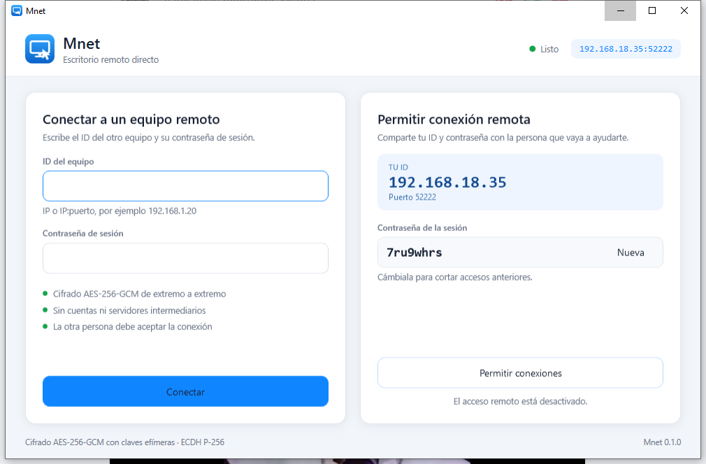

# Mconect

Escritorio remoto directo entre dos equipos Windows, con una interfaz sencilla inspirada en TeamViewer. Sin cuentas, sin servidores intermediarios y sin datos en la nube: los dos equipos se conectan entre sí por la red local o por una IP pública.



## Descargas

Última versión: **0.1.0**. Todas las versiones están en [Releases](https://github.com/montyxace-sys/Mconect/releases).

| Formato | Descarga directa |
| --- | --- |
| Portable | [Mconect.exe](https://github.com/montyxace-sys/Mconect/releases/download/v0.1.0/Mconect.exe) |
| MSI | [Mconect-0.1.0-x64.msi](https://github.com/montyxace-sys/Mconect/releases/download/v0.1.0/Mconect-0.1.0-x64.msi) |
| Instalador propio | [MconectSetup.exe](https://github.com/montyxace-sys/Mconect/releases/download/v0.1.0/MconectSetup.exe) |

Comprueba la integridad de lo descargado con [SHA256SUMS.txt](https://github.com/montyxace-sys/Mconect/releases/download/v0.1.0/SHA256SUMS.txt).

## Funciones

- Control real del ratón y del teclado del equipo remoto.
- Imagen de pantalla cifrada con AES-256-GCM y clave de sesión efímera (ECDH P-256 + HKDF-SHA256).
- Contraseña de sesión comprobada con HMAC-SHA256 en tiempo constante.
- Consentimiento explícito: la otra persona debe aceptar cada conexión; el aviso se rechaza solo a los 60 segundos.
- Pantalla completa con F11 y Salir con Esc.
- ID local visible y copiable, contraseña aleatoria y botón para generar una nueva.
- Conexión directa por IP y puerto (por defecto el 52222), sin relay ni registro.

## Cómo se usa

1. Abre Mconect en el equipo que se va a controlar y pulsa **Permitir conexiones**. Aparecerán tu ID y tu contraseña.
2. Comparte esos dos datos con la otra persona.
3. En el otro equipo escribe el ID (`192.168.1.20` o `192.168.1.20:52222`) y la contraseña, y pulsa **Conectar**.
4. En el equipo controlado aparece una solicitud de consentimiento. Si la aceptas, se abre la ventana de sesión.
5. Para terminar, pulsa **Finalizar** en cualquiera de los dos equipos.

La primera vez, Windows Defender Firewall preguntará si permites Mconect en la red. Acepta al menos para redes privadas.

## Seguridad

- La contraseña nunca viaja por la red: se demuestra su conocimiento con un HMAC sobre un secreto compartido derivado del intercambio ECDH.
- Todo el contenido de la sesión (pantalla, ratón, teclado) viaja cifrado y autenticado con AES-256-GCM.
- Una contraseña incorrecta cierra la conexión antes de mostrar nada del escritorio.
- El anfitrión siempre decide si acepta cada conexión.
- No hay cuentas, analítica ni servidores de MSoft implicados.

## Limitaciones de esta versión (0.1)

- Solo Windows 10/11 de 64 bits; el equipo que controla también debe ser Windows.
- Un monitor (el principal) y sin captura del cursor.
- Conexión por IP: no hay directorio de IDs ni NAT traversal. Para usarlo por internet hay que abrir el puerto 52222 en el router del anfitrión o usar una VPN.
- Sin audio, portapapeles compartido, transferencia de archivos ni varias sesiones a la vez.
- Ctrl+Alt+Supr no se puede enviar (limitación de Windows).

## Compilar

Requisitos: Windows, el SDK de .NET 8 y, para el MSI, WiX 4 o superior (`dotnet tool install --global wix`).

```
dotnet build Mconect.sln -c Release
```

Para generar un único ejecutable autocontenido (no necesita .NET instalado):

```
dotnet publish App/Mconect.App.csproj -c Release -r win-x64 --self-contained true -p:PublishSingleFile=true -p:IncludeNativeLibrariesForSelfExtract=true -o publish
```

## Instalar

Hay tres formatos, con el mismo programa dentro:

| Formato | Archivo | Para qué |
| --- | --- | --- |
| Portable | `Mconect.exe` | Un único ejecutable autocontenido: se copia y se abre, sin instalar nada ni necesitar .NET. |
| MSI | `Mconect-0.1.0-x64.msi` | Instalación estándar de Windows para todos los usuarios, con desinstalación desde Aplicaciones instaladas. |
| Instalador propio | `MconectSetup.exe` | Instalador con el aspecto de la app, con desinstalador propio y opción de ejecutar como administrador. |

El MSI y el instalador propio dejan Mconect en `Archivos de programa\Mconect`, con accesos directos opcionales en el escritorio y en el menú Inicio (carpeta **MSoft**). Ninguno está firmado, así que SmartScreen puede pedir confirmación la primera vez.

Para generar las tres versiones (requiere el SDK de .NET, .NET Framework 4.8 y WiX):

```
.\build-setup.ps1
```

Solo el MSI, a partir de un `publish\Mconect.exe` ya publicado:

```
wix build installer.wxs -arch x64 -o publish\Mconect-0.1.0-x64.msi
```

Las versiones antiguas de Mnet 0.1 no son compatibles: el saludo del protocolo cambió de identificador, así que hay que actualizar los dos equipos.

## Pruebas

```
dotnet run --project tests/Mconect.CoreTests -c Release
```

Las pruebas cubren el cifrado de tramas, el saludo, la autenticación con contraseña correcta e incorrecta, la serialización de mensajes y una sesión completa por TCP local con pantalla, ratón, teclado y cierre.

## Licencia

MIT © 2026 MSoft.
